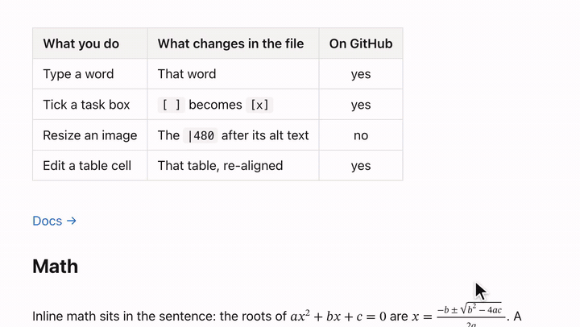

# @openmarkdown-dev/editor

A live-preview Markdown editor on CodeMirror 6 that edits the Markdown source itself, so the file you save is the file you wrote.

```sh
npm install @openmarkdown-dev/editor
```

```ts
import { createEditorState, mountEditor, openMarkdownFile, saveMarkdownFile } from "@openmarkdown-dev/editor";

const file = openMarkdownFile(new Uint8Array(await (await fetch("/notes.md")).arrayBuffer()));
const editor = mountEditor(document.getElementById("editor")!, createEditorState({ doc: file.text }));
const bytes = saveMarkdownFile(editor.getDoc(), file); // unedited: the file's own bytes
```

- **Lossless round-trip:** open a Markdown file and save it without editing, and the file is byte-for-byte what it was. What an edit may rewrite is listed under [Fidelity](#fidelity), and the [fidelity page](https://openmarkdown.dev/editor/docs/fidelity/) has a check you can run yourself.
- **Live preview:** headings, lists, tables, math, Mermaid diagrams, callouts and YAML properties render in place; the Markdown shows under the caret. The [syntax guide](https://github.com/OpenMarkdown-dev/OpenMarkdown-editor/blob/main/docs/guides/syntax.md) lists what is rendered and what is shown as written.
- **Tables in place:** edit a cell where it is drawn.
- **Images:** paste or drop them in, drag a corner to resize.
- **Framework-free:** plain TypeScript and DOM. Works with React, Vue, Svelte or nothing. Not build-free: with no bundler, [self-host it](https://github.com/OpenMarkdown-dev/OpenMarkdown-editor/blob/main/docs/guides/self-hosting.md).
- **No CSS to import:** every color and font is a `--ome-*` custom property you can override.
- **Safe with untrusted documents:** rendering a document never runs its script.
- **Lean by choice:** math and diagram renderers load only when a document needs them, or bring your own (MathJax, KaTeX, your Mermaid) with the `/no-diagrams` and `/no-renderers` entries.
- **SSR-safe import:** importing in Node does not touch `window`. Mounting needs a DOM.

[Website](https://openmarkdown.dev/editor/) · [Demo](https://openmarkdown.dev/editor/demo/) · [Examples](https://openmarkdown.dev/editor/examples/) · [Docs](https://openmarkdown.dev/editor/docs/)

Extracted from the [OpenMarkdown](https://openmarkdown.dev) app, where it is the editor
people and AI agents write in every day. MIT licensed. The [docs](https://github.com/OpenMarkdown-dev/OpenMarkdown-editor/tree/main/docs/) folder holds the
guides in plain Markdown.

## Fidelity

Lossless round-trip: open a Markdown file and save it without editing, and the file is byte-for-byte what it was.

That names one sentence of the claim below. For edits, the claim says exactly what changes. This is the whole claim. Every sentence is backed by a test:

> OpenMarkdown edits your Markdown source text directly; it never rebuilds the file from a document tree. Open and save without editing, and the file is byte-for-byte what it was: line endings (LF / CRLF), BOM, final newline, whitespace, tabs, escapes and Unicode spelling untouched. When you edit, only what you touched changes, with a few exceptions, each pinned by a test: editing a cell of an aligned table re-pads that cell when you leave it, and widens that one column when the new text no longer fits; table commands change only the rows or column they act on, in the table's own style; indenting a list item or pressing Enter in a numbered list renumbers the affected items; Enter in a list item drops trailing spaces before the cursor; a file with mixed line endings gets uniform ones once you edit it; typing on a lone blank line between two blocks adds a line break after that line, so the block below stays separate.

The claim holds when your host reads and writes the file with the package's
`openMarkdownFile` and `saveMarkdownFile`. The editor keeps the document as a string in `\n`
with no BOM; these two keep the rest of the file:

```ts
import { createEditorState, mountEditor, openMarkdownFile, saveMarkdownFile } from "@openmarkdown-dev/editor";

let file = openMarkdownFile(bytes); // strict UTF-8; notes the BOM and line endings
const editor = mountEditor(document.getElementById("editor")!, createEditorState({ doc: file.text }));

const out = saveMarkdownFile(editor.getDoc(), file); // unedited: the original bytes
```

`openMarkdownFile` throws `InvalidUtf8Error` for bytes that are not UTF-8, so a damaged file is
refused instead of silently rewritten. Unedited, `saveMarkdownFile` returns the original bytes,
even for a file that mixes line endings. Edited, it writes the BOM back and uses the file's
dominant line ending (the most frequent one; on a tie, the first) for every line.

After a save, make the bytes you wrote the new baseline: `file = openMarkdownFile(out)`. Then
`editor.getDoc() !== file.text` tells you whether there are unsaved edits.

### How it compares

We opened the same 56-line Markdown file in six embeddable editors (their npm packages, in
headless Chromium), saved it without editing, then changed one word and saved again:

| Editor | Open → save, no edit | Change one word → save |
| --- | --- | --- |
| **@openmarkdown-dev/editor** (CodeMirror 6) | byte-identical | only that word changed |
| **Atomic Editor** (CodeMirror 6) | byte-identical | only that word changed |
| Milkdown Crepe (ProseMirror) | 13 of 22 tracked features changed | the same 30 changed lines, plus the word |
| Toast UI Editor (ProseMirror) | 15 of 22 changed | the same changes, plus the word |
| Tiptap + `@tiptap/markdown` (ProseMirror) | 17 of 22 changed | the same changes, plus the word |
| MDXEditor (Lexical) | refused the file (reference links); 13 of 19 changed without them | the edit was lost on the full file |

Atomic Editor ties with us here, because it is built the same way: the source is the
document. The difference is with editors that rebuild Markdown from a tree. When we
edited one table cell (in 0.1.3, before cell edits stopped re-aligning tables), both CodeMirror editors re-aligned that table. Ours kept the
column alignment. Atomic's rewrote the delimiter row to `| --- |` and lost it.

The method, an example diff, the run date and the caveats: [How we compared editors](https://github.com/OpenMarkdown-dev/OpenMarkdown-editor/blob/main/docs/fidelity/method.md).

## Install in detail

```sh
npm install @openmarkdown-dev/editor @codemirror/state @codemirror/view @codemirror/commands \
  @codemirror/language @codemirror/lang-markdown @codemirror/lang-html \
  @codemirror/search @codemirror/autocomplete @lezer/common @lezer/highlight @lezer/markdown
```

CodeMirror and Lezer are **peer dependencies**: your page must hold exactly one copy of
`@codemirror/state`. If you already use CodeMirror, the editor shares your copy. npm 7 and
later install peers for you. `temml` (math) and `mermaid` (diagrams, `^11`) are regular
dependencies, declared as ranges so your app can share its copy. They are loaded with
`import()` only when a document contains math or a diagram, and your bundler splits them into
separate chunks. A project with a release-age gate (bun's `minimumReleaseAge`, pnpm's) refuses a
version younger than its window. It falls back to an older version only when your version range
allows one: with `^0.2.0` and 0.2.0 the newest release, the install fails until 0.2.0 is old enough
([install](https://github.com/OpenMarkdown-dev/OpenMarkdown-editor/blob/main/docs/getting-started/install.md#release-age-gates)).

### Entries and renderers

Three entries with the same API, built from the same code. They differ in the renderers they
carry built in; any of them can use yours instead ([renderers](https://github.com/OpenMarkdown-dev/OpenMarkdown-editor/blob/main/docs/guides/renderers.md)):

| Import | Formulas | Diagrams |
| --- | --- | --- |
| `@openmarkdown-dev/editor` | Temml | Mermaid |
| `@openmarkdown-dev/editor/no-diagrams` | Temml | your `renderDiagram`, or code blocks |
| `@openmarkdown-dev/editor/no-renderers` | your `renderMath`, or TeX | your `renderDiagram`, or code blocks |

Nothing `/no-diagrams` imports reaches Mermaid, and nothing `/no-renderers` imports reaches Temml
or Mermaid, so your bundler emits no chunk for them, and a one-file (IIFE) bundle does not inline
them ([bundling into one file](https://github.com/OpenMarkdown-dev/OpenMarkdown-editor/blob/main/docs/guides/bundling.md)). Use `/no-diagrams` under a style policy
Mermaid cannot meet (see [Security](#security)).

```ts
import { createEditorState, mountEditor } from "@openmarkdown-dev/editor/no-diagrams";
```

### Highlighted code blocks

Fenced code is highlighted when you opt in: install `@codemirror/language-data` and pass its
`languages` as `codeLanguages` (each language loads on first use). Without it, code blocks are
plain and no language package enters your lockfile.

```ts
import { languages } from "@codemirror/language-data";

const state = createEditorState({ doc, codeLanguages: languages });
```

### Without a bundler

Framework-free is not build-free. A page with no bundler of its own can load the prebuilt
one-file browser build, `@openmarkdown-dev/editor/browser` (CodeMirror and Temml inside; bring
your Mermaid for diagrams), or build it once and serve the files itself:
[self-hosting](https://github.com/OpenMarkdown-dev/OpenMarkdown-editor/blob/main/docs/guides/self-hosting.md) gives the build script, the output to deploy and the
Content Security Policy.

## Usage

```ts
import { configureEditorEnvironment, createEditorState, mountEditor } from "@openmarkdown-dev/editor";

// Optional, once per page: language, color scheme, clipboard, links, spelling.
configureEditorEnvironment({ language: "en" });

const state = createEditorState({
  doc: "# Hello\n\nSome *Markdown*, a table and $E = mc^2$.\n",
  host: {
    onChange: (doc, isUserEdit) => {
      if (isUserEdit) save(doc);
    },
  },
});
const editor = mountEditor(document.getElementById("editor")!, state);

editor.getDoc(); // the current Markdown, as a string
editor.setMode("source"); // "live" | "source" | "reading"
editor.focus(); // setMode does not move focus; give it back after a button click
editor.destroy(); // when the editor leaves the page
```

Give the parent element a height. The editor fills it and scrolls inside it. (For an editor
that grows with its content instead, pass `height: "auto"`; see Theming.)

### React

There is no React wrapper to install. Mount the editor in an effect:

```tsx
import { useEffect, useRef } from "react";
import { createEditorState, mountEditor, type MarkdownEditor } from "@openmarkdown-dev/editor";

export function MarkdownField({ value, onChange }: { value: string; onChange: (doc: string) => void }) {
  const parent = useRef<HTMLDivElement>(null);
  const editor = useRef<MarkdownEditor | null>(null);
  const latest = useRef(onChange);
  latest.current = onChange;

  useEffect(() => {
    const state = createEditorState({
      doc: value,
      host: { onChange: (doc, isUserEdit) => isUserEdit && latest.current(doc) },
    });
    editor.current = mountEditor(parent.current!, state);
    return () => editor.current?.destroy();
    // Mount once; later `value` changes are pushed in below.
    // eslint-disable-next-line react-hooks/exhaustive-deps
  }, []);

  useEffect(() => {
    if (editor.current && editor.current.getDoc() !== value) editor.current.setDoc(value);
  }, [value]);

  return <div ref={parent} style={{ height: 480 }} />;
}
```

`host` is read through the object on every call. You can mutate it, or read the latest
props through a ref as above, without rebuilding the state.

## API

Three functions to make an editor, four to read and write its file (as bytes or as a string), and their types. The complete, commented surface is
[`api/editor.api.d.ts`](https://github.com/OpenMarkdown-dev/OpenMarkdown-editor/blob/main/api/editor.api.d.ts), and the build checks that it matches. The
[API reference](https://openmarkdown.dev/editor/docs/api/) is generated from it.

### `createEditorState(options)` → `EditorState`

Builds a CodeMirror `EditorState` with the whole editor installed. Every option is optional:

| Option | Type | Default | What it does |
| --- | --- | --- | --- |
| `doc` | `string` | `""` | The Markdown source. |
| `mode` | `"live" \| "source" \| "reading"` | `"live"` | Live preview, plain colored source, or rendered read-only. |
| `editable` | `boolean` | `true` | `false`: read-only in every mode (no typing, pasting, checkbox ticking or property editing; no editing controls drawn). Switch with `setEditable`. |
| `docPath` | `string \| null` | `null` | The document's absolute path. Relative links and pasted images resolve against it. |
| `selection` | `{ anchor, head? }` | start of document | Where the caret starts. |
| `host` | `EditorHost` | none | Per-document callbacks (below). |
| `environment` | `EditorOwnEnvironment` | none | This editor's own color scheme, clipboard, links, spelling and keys, over the page's defaults (below). Change with `setEnvironment`. |
| `id` | `string` | none | The editable text's `id`: a `<label for>` with it focuses the editor. |
| `ariaLabel` / `ariaLabelledBy` | `string` | none | The editable text's accessible name, or the id(s) of the element(s) naming it. |
| `fromState` | CodeMirror `EditorState` | none | Take over an existing CodeMirror state: its document, selection and undo history. `doc` and `selection` are then ignored. |
| `checkSpelling` | `boolean` | `true` | Draw spelling squiggles when the environment's `spell` service is on. |
| `diagrams` | `boolean` | `true` | Render ```` ```mermaid ```` fences as diagrams (with the built-in Mermaid or your `renderDiagram`). With `false` they stay code blocks and nothing is loaded. |
| `codeLanguages` | `LanguageDescription[]` | none | Highlight fenced code in these languages, matched by the fence's info string, e.g. `languages` from `@codemirror/language-data`. Each loads on first use. Without it, code blocks are plain. |
| `extensions` | CodeMirror `Extension` or an array of them | none | Your own CodeMirror extensions, installed beside the editor's in every mode. |
| `height` | `"fill" \| "auto"` | `"fill"` | `"fill"`: the editor fills its parent (give the parent a height) and scrolls inside it. `"auto"`: it is as tall as its content and grows as you type, like a form field. |

One state is one document, with its undo history, folds and mode. A host with several
documents can keep one state each and swap them into one view with
`editor.view.setState(state)`, then call `editor.syncAmbient()`.

### `mountEditor(parent, state)` → `MarkdownEditor`

Appends an editor view to `parent` and returns a handle:

| Member | What it does |
| --- | --- |
| `view` | The CodeMirror `EditorView`, for anything not covered here. |
| `getDoc()` | The current Markdown source. |
| `setDoc(doc)` | Make `doc` the document, for example after the file changed on disk. Only the part that differs is replaced, so the reader's scroll position and selection stay. Not a user edit, not an undo step. |
| `refreshImages()` | Ask `resolveImage` again for every image, after its answer changed (the reader allowed remote images, say). |
| `mode()` / `setMode(mode)` | Read or switch the mode. The document, selection and undo history are kept. Focus does not move: call `focus()` to type right away. |
| `editable()` / `setEditable(editable)` | Read or switch whether the user may change the document. |
| `setEnvironment(environment)` | Replace this editor's own environment; a new color scheme applies at once. |
| `docPath()` / `setDocPath(path)` | Read or change the document's path, for example after a rename. |
| `undo()` / `redo()` | The editor's undo and redo, as Mod+Z / Mod+Shift+Z. `false` when there was nothing to do. |
| `openSearch()` / `closeSearch()` / `isSearchOpen()` | Open, close or ask about the find panel. |
| `revealText(text)` | Select the first occurrence of `text` and scroll it into view; `false` when it is not there. |
| `focus()` | Give the editor the keyboard focus. |
| `isUnedited(file)` | Whether the document is still `file.text` (from `openMarkdownFile` or `openMarkdownText`): an unsaved-changes test. |
| `syncAmbient()` | After swapping a state in, re-apply the current light or dark scheme. |
| `destroy()` | Remove the view and stop following the color scheme. |

### `EditorHost` (per document, passed as `host`)

Every callback is optional. When you leave one out, that feature is switched off and
nothing errors.

| Callback | Called when | Without it |
| --- | --- | --- |
| `onChange(doc, isUserEdit, docPath)` | The document changed. `isUserEdit` is false for `setDoc` and other programmatic changes. | Nothing happens. |
| `resolveImage(src)` | An image is shown. Return a URL the page may load, or `null` to show the source. Script-capable URLs are dropped whatever you return. | Only absolute `https:` images load, from any host. Pass `() => null` to load none. |
| `openLink(absPath, fragment)` | A link to a local file was followed (Cmd/Ctrl+click; a plain click in reading mode). `fragment` is its `#fragment` without the `#`, or `null`. | Local links do nothing. |
| `getFolder()` | Link completion needs the root of the user's files. | Completion uses the document's own directory. |
| `listFiles(root)` | Link completion lists linkable files under `root` (root-relative paths). | Completion offers headings only. |
| `saveAttachment(docPath, bytes, hint)` | An image is pasted or dropped into a document with a path. Store it beside the document and resolve the relative path to link, or `null`. | `uploadImage` is used, if given. |
| `uploadImage(bytes, hint)` | An image is pasted or dropped, with or without a document path (a CMS field). Store it and resolve the URL or path to link, or `null`. | Pasting or dropping an image inserts nothing (unless `saveAttachment` applies). |
| `onUnsupportedPaste(reason, count)` | Images were pasted or dropped but could not be stored: `reason` is `"no-save-attachment"` (neither saver) or `"no-doc-path"` (only `saveAttachment`, no path). Use it to tell the user. | The images are dropped silently. |
| `onMoved()` | The selection or scroll position moved (debounced). Use it to remember the position. | Nothing happens. |
| `onOutline(items)` | The heading outline changed (`OutlineItem[]`, or `null` when the view goes away). | Nothing happens. |

### `openMarkdownFile(bytes)` → `MarkdownFile` and `saveMarkdownFile(doc, file)` → `Uint8Array`

The host's file codec, pure and DOM-free (it runs in Node too). `openMarkdownFile` decodes a
file's bytes as strict UTF-8 and returns:

| Field | What it is |
| --- | --- |
| `text` | The text to edit: no BOM, every line ending as `\n`. Unicode is not normalized. |
| `bytes` | A copy of the original bytes. |
| `bom` | Whether the file started with a UTF-8 BOM. |
| `ending` | The line ending an edited save writes: `"\n"`, `"\r\n"` or `"\r"`. |
| `mixed` | Whether the file mixes line endings. |

Invalid UTF-8 throws `InvalidUtf8Error` (`code: "INVALID_UTF8"`). `saveMarkdownFile` returns
`file.bytes` while `doc` equals `file.text`, and otherwise encodes `doc` with the BOM and
`ending`. See [Fidelity](#fidelity).

A host that holds the file as a string (a CMS field, a JSON API) uses
`openMarkdownText(source)` → `MarkdownText` and `saveMarkdownText(doc, file)` → `string`: the
same codec on a string (`source` in place of `bytes`). Unedited, the saved string is `source`
exactly; edited, it keeps the BOM and the dominant line ending.

### The environment: per editor, with page defaults

Capabilities that are not about the document. Give an editor its own with
`createEditorState({ environment })` and change them with `editor.setEnvironment(...)`; set
defaults for every editor on the page with `configureEditorEnvironment(env)`, before the first
editor mounts (a later call replaces the whole set). A member an editor gives replaces the
page's for that editor. `language` is page-wide only. Every member is optional:

| Member | What it does | Without it |
| --- | --- | --- |
| `language` | The editor's own UI words: `"en"`, `"zh"`, `"ja"` or `"ko"`. | English. |
| `colorScheme` | `"light"` / `"dark"`, or `{ current(), subscribe(cb) }`, a live scheme the editor follows. | Always light. |
| `copyText(text)` | Put text on the clipboard (the code-block copy button). | No copy button action. |
| `openExternal(url)` | A web link was followed (Cmd/Ctrl+click; a plain click in reading mode). Your policy decides how it opens. | Web links do nothing. |
| `refusedLink(url, scheme)` | The editor refused a script-capable link (`javascript:`, `data:` and similar). Use it to tell the user. Never open the URL. | The refusal is silent. |
| `spell` | A `SpellService` that draws spelling squiggles and offers suggestions (`isOn`, `onChange`, `newDocument`, `check`, `suggestions`, `closeDocument`). | No spell checking. |
| `handleKey(view, event)` | Sees each key before the editor's defaults. Return `true` to consume it. | The editor's keymap only. |
| `renderMath(tex, displayMode)` | Your formula renderer (MathJax, KaTeX) in place of the built-in one; returns MathML ([renderers](https://github.com/OpenMarkdown-dev/OpenMarkdown-editor/blob/main/docs/guides/renderers.md)). | The entry's built-in Temml; with `/no-renderers`, formulas show as TeX. |
| `renderDiagram(source, scheme)` | Your diagram renderer (your page's Mermaid) in place of the built-in one; returns SVG ([renderers](https://github.com/OpenMarkdown-dev/OpenMarkdown-editor/blob/main/docs/guides/renderers.md)). | The main entry's built-in Mermaid; with the other entries, fences stay code. |

A color scheme that follows the operating system, as a page default:

```ts
const media = matchMedia("(prefers-color-scheme: dark)");
configureEditorEnvironment({
  colorScheme: {
    current: () => (media.matches ? "dark" : "light"),
    subscribe: (cb) => {
      const on = () => cb(media.matches ? "dark" : "light");
      media.addEventListener("change", on);
      return () => media.removeEventListener("change", on);
    },
  },
  copyText: (text) => navigator.clipboard.writeText(text),
  openExternal: (url) => window.open(url, "_blank", "noopener"),
});
```

## Theming

The editor paints only with `--ome-*` custom properties: colours, fonts, the type size, the
line height and the text column. Each one has a light and a dark default. To restyle the
editor, set them **on `.ome-root`**, the class of the editor's root element. Setting them on
`:root` has no effect, because the editor's own defaults win over inherited values.

```css
.ome-root {
  --ome-bg: #fffdf7;
  --ome-accent: #0b6bcb;
  --ome-font: "Inter", system-ui, sans-serif;
}
```

Do not select `.cm-editor`: a table cell or property value being edited holds a second,
small editor that is a `.cm-editor` too, so a rule there also lands in the cell. That
nested editor's root is `.ome-nested`, never `.ome-root`. These two classes and the root's
`data-ome-scheme="light" | "dark"` attribute are the public styling hooks; every other
class name inside the editor may change between versions.

| Token | Used for |
| --- | --- |
| `--ome-bg` | The document surface. |
| `--ome-fg` | Body text and the caret. |
| `--ome-muted` | Quiet surfaces. |
| `--ome-muted-fg` | Secondary text: Markdown marks, placeholders, resting controls. |
| `--ome-border` | Hairlines: table rules, quote bars, frames. |
| `--ome-accent` | Links, selection, find hits, focus, list marks. |
| `--ome-danger` | Errors, such as a search with no match. |
| `--ome-agent` | The `@agent` mention. |
| `--ome-spelling` | The spelling squiggle. |
| `--ome-code-bg` | Inline code, code blocks, table headers (translucent). |
| `--ome-callout-note`, `--ome-callout-tip`, `--ome-callout-important`, `--ome-callout-warning`, `--ome-callout-caution` | The five callout kinds. |
| `--ome-state-hover`, `--ome-state-selected` | Hover and selected layers on controls. |
| `--ome-radius` | The corner radius of controls. |
| `--ome-font`, `--ome-font-mono` | The prose and code font stacks. No font files are shipped. |
| `--ome-font-size`, `--ome-line-height` | The body text size (`16px`) and line height (`1.7`). Everything in the document is sized relative to the text size. |
| `--ome-content-width` | The text column's maximum width (`41rem`; `100%` fills the editor). |
| `--ome-padding-x`, `--ome-padding-y` | The space beside the text column (`2.5rem`) and above the first line (`2rem`). |
| `--ome-syntax-keyword`, `--ome-syntax-string`, `--ome-syntax-number`, `--ome-syntax-function`, `--ome-syntax-type`, `--ome-syntax-property` | Code highlighting. One value is used for both schemes. |

To make the editor look like part of your page (your fonts and text colour, a full-width
column), set those tokens to `inherit` and `100%`; the theming guide has the tested recipe,
"Fit the host page". For an editor that grows with its content instead of filling its
parent, as in a form, pass `height: "auto"` to `createEditorState`. The guide
[Embed in a form or CMS field](https://openmarkdown.dev/editor/docs/guides/embed-in-a-form/)
puts these together with labels, a string value, read-only and image uploads.

## Languages

The editor's own words are the find panel, copy and fold buttons, the properties block,
and image and link chips. They ship in English, Chinese, Japanese and Korean. Choose one
with `configureEditorEnvironment({ language })`. The editor does not guess from the
browser. Your document text can be in any language.

## Security

The editor is built to render documents written by someone else, such as a teammate or an
AI agent:

- **Raw HTML is shown as source**, never rendered.
- **Math** (Temml, `trust: false`) and the editor's icons reach the DOM only through one
  sanitiser with an allowlist of elements and attributes. Unknown elements make the
  formula fall back to its source. Unknown attributes are dropped.
- **Mermaid** runs with `securityLevel: "strict"` and no HTML labels. Its SVG goes through
  the same allowlist.
- **Links** are classified the way a browser reads them, after decoding entities and
  removing control characters. `javascript:`, `vbscript:`, `livescript:` and `data:` links
  are never passed to `openLink` or `openExternal`, however they are obfuscated. Your
  `refusedLink` is told instead.
- **Images**: without a `resolveImage`, only absolute `https:` images load. With one,
  script-capable URLs are still dropped.

### Known advisories

`npm audit` reports one advisory in a fresh install; npm counts it as `3 low severity
vulnerabilities`, one for each package on the path (`katex`, `mermaid` and this package). We
assessed it, and it does not apply to the editor:

- **GHSA-238p-pmpm-9mq7** (low; `katex`, installed through `mermaid` 11): "KaTeX: Existing
  prototype pollution can bypass trust restrictions". Exploiting it needs a prototype pollution
  already present in the page *and* KaTeX output inserted without sanitising. The editor renders
  math with Temml, not KaTeX. Mermaid runs with `htmlLabels: false`, so its labels are plain SVG
  text. Every piece of markup the editor inserts goes through its one sanitiser, which refuses
  anything outside its allow-list. The fix exists only in Mermaid 12, which adds a dependency
  under a license this package cannot take (EPL-2.0 OR GPL-3.0). With the `no-diagrams` or
  `no-renderers` entry, neither Mermaid nor KaTeX reaches your bundle. Next review: 2027-02-04.

The release check fails on any advisory that is not assessed here.

Content Security Policy is your page's job. CodeMirror injects `<style>` elements, so a
strict `style-src` needs a nonce through CodeMirror's `EditorView.cspNonce` (pass it with
`extensions`). That nonce is all the editor and math need. Mermaid sets inline styles while it
draws, so diagrams also need `style-src-attr` and `style-src-elem` to allow `'unsafe-inline'`,
or turn them off with `diagrams: false` or the `no-diagrams` entry
([self-hosting](https://github.com/OpenMarkdown-dev/OpenMarkdown-editor/blob/main/docs/guides/self-hosting.md#diagrams-and-the-policy)). Report vulnerabilities
privately through [GitHub security advisories](https://github.com/OpenMarkdown-dev/OpenMarkdown-editor/security/advisories/new).

## Browser support

Every build is tested by mounting, typing, rendering math and a diagram, and switching mode
and scheme in headless Chromium, WebKit (Safari's engine) and Firefox. The package is
ES2022 JavaScript. Mounting needs a DOM. Importing does not.

## Size

Measured by the release check (the numbers it holds the build to are in its budgets):

- The package's own code: about 99 KB gzipped, shipped unminified (your bundler minifies it).
- A Vite or Rollup app with the editor, first load including CodeMirror: about 185 KB gzipped,
  with any entry. HTML, CSS and JavaScript grammars, Temml and Mermaid are not in it. With
  esbuild (`--splitting`) it is about 250 KB: esbuild cannot split the HTML grammar out of
  `@codemirror/lang-markdown`, which calls it at its top level
  ([bundling](https://github.com/OpenMarkdown-dev/OpenMarkdown-editor/blob/main/docs/guides/bundling.md#first-load-with-a-splitting-bundler)).
- Loaded only when a document needs them: Temml about 58 KB, the HTML grammar about 62 KB, and
  Mermaid about 160 KB for its core, gzipped. Mermaid's diagram types load as separate chunks.
- Everything a page could ever load: about 1.25 MB gzipped with the main entry, 305 KB with
  `/no-diagrams`, 250 KB with `/no-renderers`.
- Bundled into one file (IIFE), where nothing can load later: 1214 KB, 304 KB and 246 KB
  gzipped for the three entries ([bundling into one file](https://github.com/OpenMarkdown-dev/OpenMarkdown-editor/blob/main/docs/guides/bundling.md)).

## License and trademark

The code is [MIT](https://github.com/OpenMarkdown-dev/OpenMarkdown-editor/blob/main/LICENSE). The MIT license covers the code, not the name: "OpenMarkdown"
and its logo are trademarks, and [TRADEMARK.md](https://github.com/OpenMarkdown-dev/OpenMarkdown-editor/blob/main/TRADEMARK.md) says what you may do with
them. Contributions require a [CLA](https://github.com/OpenMarkdown-dev/OpenMarkdown-editor/blob/main/CLA.md). See [CONTRIBUTING.md](https://github.com/OpenMarkdown-dev/OpenMarkdown-editor/blob/main/CONTRIBUTING.md).
