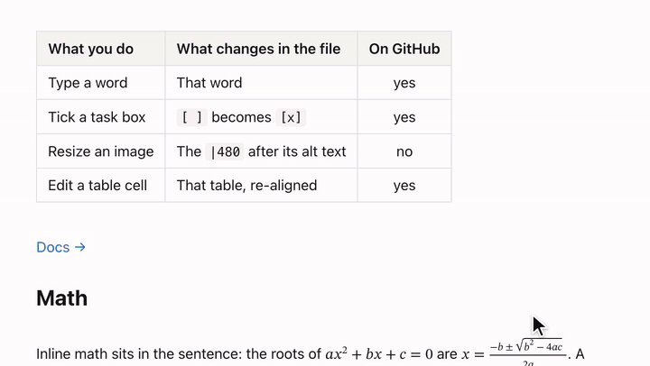

# @openmarkdown-dev/editor

A live-preview Markdown editor on CodeMirror 6 that edits the Markdown source itself, so the file you save is the file you wrote.

```sh
npm install @openmarkdown-dev/editor
```

```ts
import { createEditorState, mountEditor, openMarkdownFile, saveMarkdownFile } from "@openmarkdown-dev/editor";

const file = openMarkdownFile(new Uint8Array(await (await fetch("/notes.md")).arrayBuffer()));
const editor = mountEditor(document.getElementById("editor")!, createEditorState({ doc: file.text }));
const bytes = saveMarkdownFile(editor.getDoc(), file); // unedited: the file's own bytes
```

- **Live preview:** headings, lists, tables, math, Mermaid diagrams, callouts and YAML properties render in place; the Markdown shows under the caret.
- **Your file stays yours:** open and save without editing, and the file is byte-for-byte what it was.
- **Tables in place:** edit a cell where it is drawn.
- **Images:** paste or drop them in, drag a corner to resize.
- **Framework-free:** plain TypeScript and DOM. Works with React, Vue, Svelte or nothing. Not build-free: with no bundler, [self-host it](https://github.com/OpenMarkdown-dev/OpenMarkdown-editor/blob/main/docs/guides/self-hosting.md).
- **No CSS to import:** every color and font is a `--ome-*` custom property you can override.
- **Safe with untrusted documents:** rendering a document never runs its script.
- **Diagrams optional:** `@openmarkdown-dev/editor/no-diagrams` is the same editor without Mermaid, for a smaller build or a strict style policy.
- **SSR-safe import:** importing in Node does not touch `window`. Mounting needs a DOM.

[Website](https://openmarkdown.dev/editor/) · [Demo](https://openmarkdown.dev/editor/demo/) · [Examples](https://openmarkdown.dev/editor/examples/) · [Docs](https://openmarkdown.dev/editor/docs/)

Extracted from the [OpenMarkdown](https://openmarkdown.dev) app, where it is the editor
people and AI agents write in every day. MIT licensed. The [docs](https://github.com/OpenMarkdown-dev/OpenMarkdown-editor/tree/main/docs/) folder holds the
guides in plain Markdown.

## Fidelity

Lossless round-trip: open a Markdown file and save it without editing, and the file is byte-for-byte what it was.

That names one sentence of the claim below. For edits, the claim says exactly what changes. This is the whole claim. Every sentence is backed by a test:

> OpenMarkdown edits your Markdown source text directly; it never rebuilds the file from a document tree. Open and save without editing, and the file is byte-for-byte what it was: line endings (LF / CRLF), BOM, final newline, whitespace, tabs, escapes and Unicode spelling untouched. When you edit, only what you touched changes, with a few exceptions, each pinned by a test: a table you edit (or click into a cell of) is re-aligned as a whole when you leave it — alignment, cell text and escapes kept; table commands rewrite that table the same way; indenting a list item or pressing Enter in a numbered list renumbers the affected items; Enter in a list item drops trailing spaces before the cursor; a file with mixed line endings gets uniform ones once you edit it.

The claim holds when your host reads and writes the file with the package's
`openMarkdownFile` and `saveMarkdownFile`. The editor keeps the document as a string in `\n`
with no BOM; these two keep the rest of the file:

```ts
import { createEditorState, mountEditor, openMarkdownFile, saveMarkdownFile } from "@openmarkdown-dev/editor";

let file = openMarkdownFile(bytes); // strict UTF-8; notes the BOM and line endings
const editor = mountEditor(document.getElementById("editor")!, createEditorState({ doc: file.text }));

const out = saveMarkdownFile(editor.getDoc(), file); // unedited: the original bytes
```

`openMarkdownFile` throws `InvalidUtf8Error` for bytes that are not UTF-8, so a damaged file is
refused instead of silently rewritten. Unedited, `saveMarkdownFile` returns the original bytes,
even for a file that mixes line endings. Edited, it writes the BOM back and uses the file's
dominant line ending (the most frequent one; on a tie, the first) for every line.

After a save, make the bytes you wrote the new baseline: `file = openMarkdownFile(out)`. Then
`editor.getDoc() !== file.text` tells you whether there are unsaved edits.

### How it compares

We opened the same 56-line Markdown file in six embeddable editors (their npm packages, in
headless Chromium), saved it without editing, then changed one word and saved again:

| Editor | Open → save, no edit | Change one word → save |
| --- | --- | --- |
| **@openmarkdown-dev/editor** (CodeMirror 6) | byte-identical | only that word changed |
| **Atomic Editor** (CodeMirror 6) | byte-identical | only that word changed |
| Milkdown Crepe (ProseMirror) | 13 of 22 tracked features changed | the same 30 changed lines, plus the word |
| Toast UI Editor (ProseMirror) | 15 of 22 changed | the same changes, plus the word |
| Tiptap + `@tiptap/markdown` (ProseMirror) | 17 of 22 changed | the same changes, plus the word |
| MDXEditor (Lexical) | refused the file (reference links); 13 of 19 changed without them | the edit was lost on the full file |

Atomic Editor ties with us here, because it is built the same way: the source is the
document. The difference is with editors that rebuild Markdown from a tree. When we
edited one table cell, both CodeMirror editors re-aligned that table. Ours kept the
column alignment. Atomic's rewrote the delimiter row to `| --- |` and lost it.

The method, an example diff, the run date and the caveats: [How we compared editors](https://github.com/OpenMarkdown-dev/OpenMarkdown-editor/blob/main/docs/fidelity/method.md).

## Install in detail

```sh
npm install @openmarkdown-dev/editor @codemirror/state @codemirror/view @codemirror/commands \
  @codemirror/language @codemirror/language-data @codemirror/lang-markdown \
  @codemirror/search @codemirror/autocomplete @lezer/highlight @lezer/markdown
```

CodeMirror and Lezer are **peer dependencies**: your page must hold exactly one copy of
`@codemirror/state`. If you already use CodeMirror, the editor shares your copy. npm 7 and
later install peers for you. `temml` (math) and `mermaid` (diagrams) are regular
dependencies. They are loaded with `import()` only when a document contains math or a
diagram, and your bundler splits them into separate chunks.

### Without diagrams

`@openmarkdown-dev/editor/no-diagrams` is a second entry with the same API, built from the same
code, minus diagram support. Nothing it imports reaches Mermaid, so your bundler emits no
Mermaid chunks at all; a ```` ```mermaid ```` block stays a code block and the `diagrams` option
is ignored. Use it when no page needs diagrams, or under a style policy Mermaid cannot meet
(see [Security](#security)). npm still installs `mermaid`, because the main entry depends on
it.

```ts
import { createEditorState, mountEditor } from "@openmarkdown-dev/editor/no-diagrams";
```

### Without a bundler

Framework-free is not build-free. A page with no bundler of its own can load the editor from a
CDN once the package is published there, or build it once and serve the files itself:
[self-hosting](https://github.com/OpenMarkdown-dev/OpenMarkdown-editor/blob/main/docs/guides/self-hosting.md) gives the build script, the output to deploy and the
Content Security Policy.

## Usage

```ts
import { configureEditorEnvironment, createEditorState, mountEditor } from "@openmarkdown-dev/editor";

// Optional, once per page: language, color scheme, clipboard, links, spelling.
configureEditorEnvironment({ language: "en" });

const state = createEditorState({
  doc: "# Hello\n\nSome *Markdown*, a table and $E = mc^2$.\n",
  host: {
    onChange: (doc, isUserEdit) => {
      if (isUserEdit) save(doc);
    },
  },
});
const editor = mountEditor(document.getElementById("editor")!, state);

editor.getDoc(); // the current Markdown, as a string
editor.setMode("source"); // "live" | "source" | "reading"
editor.view.focus(); // setMode does not move focus; give it back after a button click
editor.destroy(); // when the editor leaves the page
```

Give the parent element a height. The editor fills it and scrolls inside it.

### React

There is no React wrapper to install. Mount the editor in an effect:

```tsx
import { useEffect, useRef } from "react";
import { createEditorState, mountEditor, type MarkdownEditor } from "@openmarkdown-dev/editor";

export function MarkdownField({ value, onChange }: { value: string; onChange: (doc: string) => void }) {
  const parent = useRef<HTMLDivElement>(null);
  const editor = useRef<MarkdownEditor | null>(null);
  const latest = useRef(onChange);
  latest.current = onChange;

  useEffect(() => {
    const state = createEditorState({
      doc: value,
      host: { onChange: (doc, isUserEdit) => isUserEdit && latest.current(doc) },
    });
    editor.current = mountEditor(parent.current!, state);
    return () => editor.current?.destroy();
    // Mount once; later `value` changes are pushed in below.
    // eslint-disable-next-line react-hooks/exhaustive-deps
  }, []);

  useEffect(() => {
    if (editor.current && editor.current.getDoc() !== value) editor.current.setDoc(value);
  }, [value]);

  return <div ref={parent} style={{ height: 480 }} />;
}
```

`host` is read through the object on every call. You can mutate it, or read the latest
props through a ref as above, without rebuilding the state.

## API

Three functions to make an editor, two to read and write its file, and their types. The complete, commented surface is
[`api/editor.api.d.ts`](https://github.com/OpenMarkdown-dev/OpenMarkdown-editor/blob/main/api/editor.api.d.ts), and the build checks that it matches. The
[API reference](https://openmarkdown.dev/editor/docs/api/) is generated from it.

### `createEditorState(options)` → `EditorState`

Builds a CodeMirror `EditorState` with the whole editor installed. Every option is optional:

| Option | Type | Default | What it does |
| --- | --- | --- | --- |
| `doc` | `string` | `""` | The Markdown source. |
| `mode` | `"live" \| "source" \| "reading"` | `"live"` | Live preview, plain colored source, or rendered read-only. |
| `docPath` | `string \| null` | `null` | The document's absolute path. Relative links and pasted images resolve against it. |
| `selection` | `{ anchor, head? }` | start of document | Where the caret starts. |
| `host` | `EditorHost` | none | Per-document callbacks (below). |
| `checkSpelling` | `boolean` | `true` | Draw spelling squiggles when the environment's `spell` service is on. |
| `diagrams` | `boolean` | `true` | Render ```` ```mermaid ```` fences as diagrams. With `false` they stay code blocks and Mermaid is never loaded. |
| `extensions` | CodeMirror `Extension` | none | Your own CodeMirror extensions, installed beside the editor's in every mode. |

One state is one document, with its undo history, folds and mode. A host with several
documents can keep one state each and swap them into one view with
`editor.view.setState(state)`, then call `editor.syncAmbient()`.

### `mountEditor(parent, state)` → `MarkdownEditor`

Appends an editor view to `parent` and returns a handle:

| Member | What it does |
| --- | --- |
| `view` | The CodeMirror `EditorView`, for anything not covered here. |
| `getDoc()` | The current Markdown source. |
| `setDoc(doc)` | Make `doc` the document, for example after the file changed on disk. Only the part that differs is replaced, so the reader's scroll position and selection stay. Not a user edit, not an undo step. |
| `refreshImages()` | Ask `resolveImage` again for every image, after its answer changed (the reader allowed remote images, say). |
| `mode()` / `setMode(mode)` | Read or switch the mode. The document, selection and undo history are kept. Focus does not move: call `view.focus()` to type right away. |
| `docPath()` / `setDocPath(path)` | Read or change the document's path, for example after a rename. |
| `syncAmbient()` | After swapping a state in, re-apply the current light or dark scheme. |
| `destroy()` | Remove the view and stop following the color scheme. |

### `EditorHost` (per document, passed as `host`)

Every callback is optional. When you leave one out, that feature is switched off and
nothing errors.

| Callback | Called when | Without it |
| --- | --- | --- |
| `onChange(doc, isUserEdit, docPath)` | The document changed. `isUserEdit` is false for `setDoc` and other programmatic changes. | Nothing happens. |
| `resolveImage(src)` | An image is shown. Return a URL the page may load, or `null` to show the source. Script-capable URLs are dropped whatever you return. | Only absolute `https:` images load, from any host. Pass `() => null` to load none. |
| `openLink(absPath, fragment)` | A link to a local file was followed (Cmd/Ctrl+click; a plain click in reading mode). `fragment` is its `#fragment` without the `#`, or `null`. | Local links do nothing. |
| `getFolder()` | Link completion needs the root of the user's files. | Completion uses the document's own directory. |
| `listFiles(root)` | Link completion lists linkable files under `root` (root-relative paths). | Completion offers headings only. |
| `saveAttachment(docPath, bytes, hint)` | An image is pasted or dropped. Store it and resolve the relative path to link, or `null`. | Pasting or dropping an image inserts nothing. |
| `onUnsupportedPaste(reason, count)` | Images were pasted or dropped but could not be stored: `reason` is `"no-save-attachment"` or `"no-doc-path"`. Use it to tell the user. | The images are dropped silently. |
| `onMoved()` | The selection or scroll position moved (debounced). Use it to remember the position. | Nothing happens. |
| `onOutline(items)` | The heading outline changed (`OutlineItem[]`, or `null` when the view goes away). | Nothing happens. |

### `openMarkdownFile(bytes)` → `MarkdownFile` and `saveMarkdownFile(doc, file)` → `Uint8Array`

The host's file codec, pure and DOM-free (it runs in Node too). `openMarkdownFile` decodes a
file's bytes as strict UTF-8 and returns:

| Field | What it is |
| --- | --- |
| `text` | The text to edit: no BOM, every line ending as `\n`. Unicode is not normalized. |
| `bytes` | A copy of the original bytes. |
| `bom` | Whether the file started with a UTF-8 BOM. |
| `ending` | The line ending an edited save writes: `"\n"`, `"\r\n"` or `"\r"`. |
| `mixed` | Whether the file mixes line endings. |

Invalid UTF-8 throws `InvalidUtf8Error` (`code: "INVALID_UTF8"`). `saveMarkdownFile` returns
`file.bytes` while `doc` equals `file.text`, and otherwise encodes `doc` with the BOM and
`ending`. See [Fidelity](#fidelity).

### `configureEditorEnvironment(env)` (once per page)

Window-wide capabilities. Call it before the first editor mounts. A later call replaces
the whole environment. Every member is optional:

| Member | What it does | Without it |
| --- | --- | --- |
| `language` | The editor's own UI words: `"en"`, `"zh"`, `"ja"` or `"ko"`. | English. |
| `colorScheme` | `{ current(), subscribe(cb) }`: the page's `"light"` / `"dark"` scheme and its changes. | Always light. |
| `copyText(text)` | Put text on the clipboard (the code-block copy button). | No copy button action. |
| `openExternal(url)` | A web link was followed (Cmd/Ctrl+click; a plain click in reading mode). Your policy decides how it opens. | Web links do nothing. |
| `refusedLink(url, scheme)` | The editor refused a script-capable link (`javascript:`, `data:` and similar). Use it to tell the user. Never open the URL. | The refusal is silent. |
| `spell` | A `SpellService` that draws spelling squiggles and offers suggestions (`isOn`, `onChange`, `newDocument`, `check`, `suggestions`, `closeDocument`). | No spell checking. |
| `handleKey(view, event)` | Sees each key before the editor's defaults. Return `true` to consume it. | The editor's keymap only. |

A color scheme that follows the operating system:

```ts
const media = matchMedia("(prefers-color-scheme: dark)");
configureEditorEnvironment({
  colorScheme: {
    current: () => (media.matches ? "dark" : "light"),
    subscribe: (cb) => {
      const on = () => cb(media.matches ? "dark" : "light");
      media.addEventListener("change", on);
      return () => media.removeEventListener("change", on);
    },
  },
  copyText: (text) => navigator.clipboard.writeText(text),
  openExternal: (url) => window.open(url, "_blank", "noopener"),
});
```

## Theming

The editor paints only with `--ome-*` custom properties. Each one has a light and a dark
default. To restyle the editor, set them **on `.cm-editor`**. Setting them on `:root` has
no effect, because the editor's own defaults win over inherited values.

```css
.cm-editor {
  --ome-bg: #fffdf7;
  --ome-accent: #0b6bcb;
  --ome-font: "Inter", system-ui, sans-serif;
}
```

| Token | Used for |
| --- | --- |
| `--ome-bg` | The document surface. |
| `--ome-fg` | Body text and the caret. |
| `--ome-muted` | Quiet surfaces. |
| `--ome-muted-fg` | Secondary text: Markdown marks, placeholders, resting controls. |
| `--ome-border` | Hairlines: table rules, quote bars, frames. |
| `--ome-accent` | Links, selection, find hits, focus, list marks. |
| `--ome-danger` | Errors, such as a search with no match. |
| `--ome-agent` | The `@agent` mention. |
| `--ome-spelling` | The spelling squiggle. |
| `--ome-code-bg` | Inline code, code blocks, table headers (translucent). |
| `--ome-callout-note`, `--ome-callout-tip`, `--ome-callout-important`, `--ome-callout-warning`, `--ome-callout-caution` | The five callout kinds. |
| `--ome-state-hover`, `--ome-state-selected` | Hover and selected layers on controls. |
| `--ome-radius` | The corner radius of controls. |
| `--ome-font`, `--ome-font-mono` | The prose and code font stacks. No font files are shipped. |
| `--ome-syntax-keyword`, `--ome-syntax-string`, `--ome-syntax-number`, `--ome-syntax-function`, `--ome-syntax-type`, `--ome-syntax-property` | Code highlighting. One value is used for both schemes. |

## Languages

The editor's own words are the find panel, copy and fold buttons, the properties block,
and image and link chips. They ship in English, Chinese, Japanese and Korean. Choose one
with `configureEditorEnvironment({ language })`. The editor does not guess from the
browser. Your document text can be in any language.

## Security

The editor is built to render documents written by someone else, such as a teammate or an
AI agent:

- **Raw HTML is shown as source**, never rendered.
- **Math** (Temml, `trust: false`) and the editor's icons reach the DOM only through one
  sanitiser with an allowlist of elements and attributes. Unknown elements make the
  formula fall back to its source. Unknown attributes are dropped.
- **Mermaid** runs with `securityLevel: "strict"` and no HTML labels. Its SVG goes through
  the same allowlist.
- **Links** are classified the way a browser reads them, after decoding entities and
  removing control characters. `javascript:`, `vbscript:`, `livescript:` and `data:` links
  are never passed to `openLink` or `openExternal`, however they are obfuscated. Your
  `refusedLink` is told instead.
- **Images**: without a `resolveImage`, only absolute `https:` images load. With one,
  script-capable URLs are still dropped.

### Known advisories

`npm audit` reports one advisory in a fresh install; npm counts it as `3 low severity
vulnerabilities`, one for each package on the path (`katex`, `mermaid` and this package). We
assessed it, and it does not apply to the editor:

- **GHSA-238p-pmpm-9mq7** (low; `katex`, installed through `mermaid` 11.17.2): "KaTeX: Existing
  prototype pollution can bypass trust restrictions". Exploiting it needs a prototype pollution
  already present in the page *and* KaTeX output inserted without sanitising. The editor renders
  math with Temml, not KaTeX. Mermaid runs with `htmlLabels: false`, so its labels are plain SVG
  text. Every piece of markup the editor inserts goes through its one sanitiser, which refuses
  anything outside its allow-list. The fix exists only in Mermaid 12, which adds a dependency
  under a license this package cannot take (EPL-2.0 OR GPL-3.0). With the `no-diagrams` entry,
  neither Mermaid nor KaTeX reaches your bundle. Next review: 2027-02-04.

The release check fails on any advisory that is not assessed here.

Content Security Policy is your page's job. CodeMirror injects `<style>` elements, so a
strict `style-src` needs a nonce through CodeMirror's `EditorView.cspNonce` (pass it with
`extensions`). That nonce is all the editor and math need. Mermaid sets inline styles while it
draws, so diagrams also need `style-src-attr` and `style-src-elem` to allow `'unsafe-inline'`,
or turn them off with `diagrams: false` or the `no-diagrams` entry
([self-hosting](https://github.com/OpenMarkdown-dev/OpenMarkdown-editor/blob/main/docs/guides/self-hosting.md#diagrams-and-the-policy)). Report vulnerabilities
privately through [GitHub security advisories](https://github.com/OpenMarkdown-dev/OpenMarkdown-editor/security/advisories/new).

## Browser support

Every build is tested by mounting, typing, rendering math and a diagram, and switching mode
and scheme in headless Chromium, WebKit (Safari's engine) and Firefox. The package is
ES2022 JavaScript. Mounting needs a DOM. Importing does not.

## Size

Measured from the 0.1.0 build:

- The package's own code: about 78 KB gzipped (shipped unminified; your bundler minifies it).
- A Vite app with the editor, first load including CodeMirror: about 245 KB gzipped.
- Loaded only when a document needs them: Temml about 58 KB and Mermaid about 160 KB
  for its core, gzipped. Mermaid's diagram types load as separate chunks.
- With the `no-diagrams` entry, first load is the same, and the whole build (every chunk
  a page might ever load) drops from about 1.6 MB to about 680 KB gzipped: no Mermaid chunks.

## License and trademark

The code is [MIT](https://github.com/OpenMarkdown-dev/OpenMarkdown-editor/blob/main/LICENSE). The MIT license covers the code, not the name: "OpenMarkdown"
and its logo are trademarks, and [TRADEMARK.md](https://github.com/OpenMarkdown-dev/OpenMarkdown-editor/blob/main/TRADEMARK.md) says what you may do with
them. Contributions require a [CLA](https://github.com/OpenMarkdown-dev/OpenMarkdown-editor/blob/main/CLA.md). See [CONTRIBUTING.md](https://github.com/OpenMarkdown-dev/OpenMarkdown-editor/blob/main/CONTRIBUTING.md).
