# 大型 Mermaid 图(性能)

验证 change `mermaid-large-diagrams`:规模(语句数 + 连线数)超过阈值的图不自动渲染,显示占位里的提示与「渲染」按钮;点了才渲染一次。也是 `scripts/measure-mermaid-render.mjs` 的计时素材(每节一张图,节名是脚本里的名字)。

## (a) 400-edge graph TD

stress report bug 3 的写法(`N0[Node 0] --> N3`)的重建:原文档没留下,这里是 0–199 号节点各向后连 1 与 3,共 400 条边。

```mermaid
graph TD
  N0[Node 0] --> N1
  N0 --> N3
  N1[Node 1] --> N2
  N1 --> N4
  N2[Node 2] --> N3
  N2 --> N5
  N3[Node 3] --> N4
  N3 --> N6
  N4[Node 4] --> N5
  N4 --> N7
  N5[Node 5] --> N6
  N5 --> N8
  N6[Node 6] --> N7
  N6 --> N9
  N7[Node 7] --> N8
  N7 --> N10
  N8[Node 8] --> N9
  N8 --> N11
  N9[Node 9] --> N10
  N9 --> N12
  N10[Node 10] --> N11
  N10 --> N13
  N11[Node 11] --> N12
  N11 --> N14
  N12[Node 12] --> N13
  N12 --> N15
  N13[Node 13] --> N14
  N13 --> N16
  N14[Node 14] --> N15
  N14 --> N17
  N15[Node 15] --> N16
  N15 --> N18
  N16[Node 16] --> N17
  N16 --> N19
  N17[Node 17] --> N18
  N17 --> N20
  N18[Node 18] --> N19
  N18 --> N21
  N19[Node 19] --> N20
  N19 --> N22
  N20[Node 20] --> N21
  N20 --> N23
  N21[Node 21] --> N22
  N21 --> N24
  N22[Node 22] --> N23
  N22 --> N25
  N23[Node 23] --> N24
  N23 --> N26
  N24[Node 24] --> N25
  N24 --> N27
  N25[Node 25] --> N26
  N25 --> N28
  N26[Node 26] --> N27
  N26 --> N29
  N27[Node 27] --> N28
  N27 --> N30
  N28[Node 28] --> N29
  N28 --> N31
  N29[Node 29] --> N30
  N29 --> N32
  N30[Node 30] --> N31
  N30 --> N33
  N31[Node 31] --> N32
  N31 --> N34
  N32[Node 32] --> N33
  N32 --> N35
  N33[Node 33] --> N34
  N33 --> N36
  N34[Node 34] --> N35
  N34 --> N37
  N35[Node 35] --> N36
  N35 --> N38
  N36[Node 36] --> N37
  N36 --> N39
  N37[Node 37] --> N38
  N37 --> N40
  N38[Node 38] --> N39
  N38 --> N41
  N39[Node 39] --> N40
  N39 --> N42
  N40[Node 40] --> N41
  N40 --> N43
  N41[Node 41] --> N42
  N41 --> N44
  N42[Node 42] --> N43
  N42 --> N45
  N43[Node 43] --> N44
  N43 --> N46
  N44[Node 44] --> N45
  N44 --> N47
  N45[Node 45] --> N46
  N45 --> N48
  N46[Node 46] --> N47
  N46 --> N49
  N47[Node 47] --> N48
  N47 --> N50
  N48[Node 48] --> N49
  N48 --> N51
  N49[Node 49] --> N50
  N49 --> N52
  N50[Node 50] --> N51
  N50 --> N53
  N51[Node 51] --> N52
  N51 --> N54
  N52[Node 52] --> N53
  N52 --> N55
  N53[Node 53] --> N54
  N53 --> N56
  N54[Node 54] --> N55
  N54 --> N57
  N55[Node 55] --> N56
  N55 --> N58
  N56[Node 56] --> N57
  N56 --> N59
  N57[Node 57] --> N58
  N57 --> N60
  N58[Node 58] --> N59
  N58 --> N61
  N59[Node 59] --> N60
  N59 --> N62
  N60[Node 60] --> N61
  N60 --> N63
  N61[Node 61] --> N62
  N61 --> N64
  N62[Node 62] --> N63
  N62 --> N65
  N63[Node 63] --> N64
  N63 --> N66
  N64[Node 64] --> N65
  N64 --> N67
  N65[Node 65] --> N66
  N65 --> N68
  N66[Node 66] --> N67
  N66 --> N69
  N67[Node 67] --> N68
  N67 --> N70
  N68[Node 68] --> N69
  N68 --> N71
  N69[Node 69] --> N70
  N69 --> N72
  N70[Node 70] --> N71
  N70 --> N73
  N71[Node 71] --> N72
  N71 --> N74
  N72[Node 72] --> N73
  N72 --> N75
  N73[Node 73] --> N74
  N73 --> N76
  N74[Node 74] --> N75
  N74 --> N77
  N75[Node 75] --> N76
  N75 --> N78
  N76[Node 76] --> N77
  N76 --> N79
  N77[Node 77] --> N78
  N77 --> N80
  N78[Node 78] --> N79
  N78 --> N81
  N79[Node 79] --> N80
  N79 --> N82
  N80[Node 80] --> N81
  N80 --> N83
  N81[Node 81] --> N82
  N81 --> N84
  N82[Node 82] --> N83
  N82 --> N85
  N83[Node 83] --> N84
  N83 --> N86
  N84[Node 84] --> N85
  N84 --> N87
  N85[Node 85] --> N86
  N85 --> N88
  N86[Node 86] --> N87
  N86 --> N89
  N87[Node 87] --> N88
  N87 --> N90
  N88[Node 88] --> N89
  N88 --> N91
  N89[Node 89] --> N90
  N89 --> N92
  N90[Node 90] --> N91
  N90 --> N93
  N91[Node 91] --> N92
  N91 --> N94
  N92[Node 92] --> N93
  N92 --> N95
  N93[Node 93] --> N94
  N93 --> N96
  N94[Node 94] --> N95
  N94 --> N97
  N95[Node 95] --> N96
  N95 --> N98
  N96[Node 96] --> N97
  N96 --> N99
  N97[Node 97] --> N98
  N97 --> N100
  N98[Node 98] --> N99
  N98 --> N101
  N99[Node 99] --> N100
  N99 --> N102
  N100[Node 100] --> N101
  N100 --> N103
  N101[Node 101] --> N102
  N101 --> N104
  N102[Node 102] --> N103
  N102 --> N105
  N103[Node 103] --> N104
  N103 --> N106
  N104[Node 104] --> N105
  N104 --> N107
  N105[Node 105] --> N106
  N105 --> N108
  N106[Node 106] --> N107
  N106 --> N109
  N107[Node 107] --> N108
  N107 --> N110
  N108[Node 108] --> N109
  N108 --> N111
  N109[Node 109] --> N110
  N109 --> N112
  N110[Node 110] --> N111
  N110 --> N113
  N111[Node 111] --> N112
  N111 --> N114
  N112[Node 112] --> N113
  N112 --> N115
  N113[Node 113] --> N114
  N113 --> N116
  N114[Node 114] --> N115
  N114 --> N117
  N115[Node 115] --> N116
  N115 --> N118
  N116[Node 116] --> N117
  N116 --> N119
  N117[Node 117] --> N118
  N117 --> N120
  N118[Node 118] --> N119
  N118 --> N121
  N119[Node 119] --> N120
  N119 --> N122
  N120[Node 120] --> N121
  N120 --> N123
  N121[Node 121] --> N122
  N121 --> N124
  N122[Node 122] --> N123
  N122 --> N125
  N123[Node 123] --> N124
  N123 --> N126
  N124[Node 124] --> N125
  N124 --> N127
  N125[Node 125] --> N126
  N125 --> N128
  N126[Node 126] --> N127
  N126 --> N129
  N127[Node 127] --> N128
  N127 --> N130
  N128[Node 128] --> N129
  N128 --> N131
  N129[Node 129] --> N130
  N129 --> N132
  N130[Node 130] --> N131
  N130 --> N133
  N131[Node 131] --> N132
  N131 --> N134
  N132[Node 132] --> N133
  N132 --> N135
  N133[Node 133] --> N134
  N133 --> N136
  N134[Node 134] --> N135
  N134 --> N137
  N135[Node 135] --> N136
  N135 --> N138
  N136[Node 136] --> N137
  N136 --> N139
  N137[Node 137] --> N138
  N137 --> N140
  N138[Node 138] --> N139
  N138 --> N141
  N139[Node 139] --> N140
  N139 --> N142
  N140[Node 140] --> N141
  N140 --> N143
  N141[Node 141] --> N142
  N141 --> N144
  N142[Node 142] --> N143
  N142 --> N145
  N143[Node 143] --> N144
  N143 --> N146
  N144[Node 144] --> N145
  N144 --> N147
  N145[Node 145] --> N146
  N145 --> N148
  N146[Node 146] --> N147
  N146 --> N149
  N147[Node 147] --> N148
  N147 --> N150
  N148[Node 148] --> N149
  N148 --> N151
  N149[Node 149] --> N150
  N149 --> N152
  N150[Node 150] --> N151
  N150 --> N153
  N151[Node 151] --> N152
  N151 --> N154
  N152[Node 152] --> N153
  N152 --> N155
  N153[Node 153] --> N154
  N153 --> N156
  N154[Node 154] --> N155
  N154 --> N157
  N155[Node 155] --> N156
  N155 --> N158
  N156[Node 156] --> N157
  N156 --> N159
  N157[Node 157] --> N158
  N157 --> N160
  N158[Node 158] --> N159
  N158 --> N161
  N159[Node 159] --> N160
  N159 --> N162
  N160[Node 160] --> N161
  N160 --> N163
  N161[Node 161] --> N162
  N161 --> N164
  N162[Node 162] --> N163
  N162 --> N165
  N163[Node 163] --> N164
  N163 --> N166
  N164[Node 164] --> N165
  N164 --> N167
  N165[Node 165] --> N166
  N165 --> N168
  N166[Node 166] --> N167
  N166 --> N169
  N167[Node 167] --> N168
  N167 --> N170
  N168[Node 168] --> N169
  N168 --> N171
  N169[Node 169] --> N170
  N169 --> N172
  N170[Node 170] --> N171
  N170 --> N173
  N171[Node 171] --> N172
  N171 --> N174
  N172[Node 172] --> N173
  N172 --> N175
  N173[Node 173] --> N174
  N173 --> N176
  N174[Node 174] --> N175
  N174 --> N177
  N175[Node 175] --> N176
  N175 --> N178
  N176[Node 176] --> N177
  N176 --> N179
  N177[Node 177] --> N178
  N177 --> N180
  N178[Node 178] --> N179
  N178 --> N181
  N179[Node 179] --> N180
  N179 --> N182
  N180[Node 180] --> N181
  N180 --> N183
  N181[Node 181] --> N182
  N181 --> N184
  N182[Node 182] --> N183
  N182 --> N185
  N183[Node 183] --> N184
  N183 --> N186
  N184[Node 184] --> N185
  N184 --> N187
  N185[Node 185] --> N186
  N185 --> N188
  N186[Node 186] --> N187
  N186 --> N189
  N187[Node 187] --> N188
  N187 --> N190
  N188[Node 188] --> N189
  N188 --> N191
  N189[Node 189] --> N190
  N189 --> N192
  N190[Node 190] --> N191
  N190 --> N193
  N191[Node 191] --> N192
  N191 --> N194
  N192[Node 192] --> N193
  N192 --> N195
  N193[Node 193] --> N194
  N193 --> N196
  N194[Node 194] --> N195
  N194 --> N197
  N195[Node 195] --> N196
  N195 --> N198
  N196[Node 196] --> N197
  N196 --> N199
  N197[Node 197] --> N198
  N197 --> N200
  N198[Node 198] --> N199
  N198 --> N201
  N199[Node 199] --> N200
  N199 --> N202
```

## (b) 400-node flat graph TD

bug 8 的形状:一个根、三层、每层几百个节点(扁平而宽)。

## (c) 300-message sequenceDiagram

```mermaid
sequenceDiagram
  participant Alice
  participant Bob
  participant Carol
  participant Dave
  Alice->>Bob: message 0
  Bob->>Carol: message 1
  Carol->>Dave: message 2
  Dave->>Alice: message 3
  Alice->>Bob: message 4
  Bob->>Carol: message 5
  Carol->>Dave: message 6
  Dave->>Alice: message 7
  Alice->>Bob: message 8
  Bob->>Carol: message 9
  Carol->>Dave: message 10
  Dave->>Alice: message 11
  Alice->>Bob: message 12
  Bob->>Carol: message 13
  Carol->>Dave: message 14
  Dave->>Alice: message 15
  Alice->>Bob: message 16
  Bob->>Carol: message 17
  Carol->>Dave: message 18
  Dave->>Alice: message 19
  Alice->>Bob: message 20
  Bob->>Carol: message 21
  Carol->>Dave: message 22
  Dave->>Alice: message 23
  Alice->>Bob: message 24
  Bob->>Carol: message 25
  Carol->>Dave: message 26
  Dave->>Alice: message 27
  Alice->>Bob: message 28
  Bob->>Carol: message 29
  Carol->>Dave: message 30
  Dave->>Alice: message 31
  Alice->>Bob: message 32
  Bob->>Carol: message 33
  Carol->>Dave: message 34
  Dave->>Alice: message 35
  Alice->>Bob: message 36
  Bob->>Carol: message 37
  Carol->>Dave: message 38
  Dave->>Alice: message 39
  Alice->>Bob: message 40
  Bob->>Carol: message 41
  Carol->>Dave: message 42
  Dave->>Alice: message 43
  Alice->>Bob: message 44
  Bob->>Carol: message 45
  Carol->>Dave: message 46
  Dave->>Alice: message 47
  Alice->>Bob: message 48
  Bob->>Carol: message 49
  Carol->>Dave: message 50
  Dave->>Alice: message 51
  Alice->>Bob: message 52
  Bob->>Carol: message 53
  Carol->>Dave: message 54
  Dave->>Alice: message 55
  Alice->>Bob: message 56
  Bob->>Carol: message 57
  Carol->>Dave: message 58
  Dave->>Alice: message 59
  Alice->>Bob: message 60
  Bob->>Carol: message 61
  Carol->>Dave: message 62
  Dave->>Alice: message 63
  Alice->>Bob: message 64
  Bob->>Carol: message 65
  Carol->>Dave: message 66
  Dave->>Alice: message 67
  Alice->>Bob: message 68
  Bob->>Carol: message 69
  Carol->>Dave: message 70
  Dave->>Alice: message 71
  Alice->>Bob: message 72
  Bob->>Carol: message 73
  Carol->>Dave: message 74
  Dave->>Alice: message 75
  Alice->>Bob: message 76
  Bob->>Carol: message 77
  Carol->>Dave: message 78
  Dave->>Alice: message 79
  Alice->>Bob: message 80
  Bob->>Carol: message 81
  Carol->>Dave: message 82
  Dave->>Alice: message 83
  Alice->>Bob: message 84
  Bob->>Carol: message 85
  Carol->>Dave: message 86
  Dave->>Alice: message 87
  Alice->>Bob: message 88
  Bob->>Carol: message 89
  Carol->>Dave: message 90
  Dave->>Alice: message 91
  Alice->>Bob: message 92
  Bob->>Carol: message 93
  Carol->>Dave: message 94
  Dave->>Alice: message 95
  Alice->>Bob: message 96
  Bob->>Carol: message 97
  Carol->>Dave: message 98
  Dave->>Alice: message 99
  Alice->>Bob: message 100
  Bob->>Carol: message 101
  Carol->>Dave: message 102
  Dave->>Alice: message 103
  Alice->>Bob: message 104
  Bob->>Carol: message 105
  Carol->>Dave: message 106
  Dave->>Alice: message 107
  Alice->>Bob: message 108
  Bob->>Carol: message 109
  Carol->>Dave: message 110
  Dave->>Alice: message 111
  Alice->>Bob: message 112
  Bob->>Carol: message 113
  Carol->>Dave: message 114
  Dave->>Alice: message 115
  Alice->>Bob: message 116
  Bob->>Carol: message 117
  Carol->>Dave: message 118
  Dave->>Alice: message 119
  Alice->>Bob: message 120
  Bob->>Carol: message 121
  Carol->>Dave: message 122
  Dave->>Alice: message 123
  Alice->>Bob: message 124
  Bob->>Carol: message 125
  Carol->>Dave: message 126
  Dave->>Alice: message 127
  Alice->>Bob: message 128
  Bob->>Carol: message 129
  Carol->>Dave: message 130
  Dave->>Alice: message 131
  Alice->>Bob: message 132
  Bob->>Carol: message 133
  Carol->>Dave: message 134
  Dave->>Alice: message 135
  Alice->>Bob: message 136
  Bob->>Carol: message 137
  Carol->>Dave: message 138
  Dave->>Alice: message 139
  Alice->>Bob: message 140
  Bob->>Carol: message 141
  Carol->>Dave: message 142
  Dave->>Alice: message 143
  Alice->>Bob: message 144
  Bob->>Carol: message 145
  Carol->>Dave: message 146
  Dave->>Alice: message 147
  Alice->>Bob: message 148
  Bob->>Carol: message 149
  Carol->>Dave: message 150
  Dave->>Alice: message 151
  Alice->>Bob: message 152
  Bob->>Carol: message 153
  Carol->>Dave: message 154
  Dave->>Alice: message 155
  Alice->>Bob: message 156
  Bob->>Carol: message 157
  Carol->>Dave: message 158
  Dave->>Alice: message 159
  Alice->>Bob: message 160
  Bob->>Carol: message 161
  Carol->>Dave: message 162
  Dave->>Alice: message 163
  Alice->>Bob: message 164
  Bob->>Carol: message 165
  Carol->>Dave: message 166
  Dave->>Alice: message 167
  Alice->>Bob: message 168
  Bob->>Carol: message 169
  Carol->>Dave: message 170
  Dave->>Alice: message 171
  Alice->>Bob: message 172
  Bob->>Carol: message 173
  Carol->>Dave: message 174
  Dave->>Alice: message 175
  Alice->>Bob: message 176
  Bob->>Carol: message 177
  Carol->>Dave: message 178
  Dave->>Alice: message 179
  Alice->>Bob: message 180
  Bob->>Carol: message 181
  Carol->>Dave: message 182
  Dave->>Alice: message 183
  Alice->>Bob: message 184
  Bob->>Carol: message 185
  Carol->>Dave: message 186
  Dave->>Alice: message 187
  Alice->>Bob: message 188
  Bob->>Carol: message 189
  Carol->>Dave: message 190
  Dave->>Alice: message 191
  Alice->>Bob: message 192
  Bob->>Carol: message 193
  Carol->>Dave: message 194
  Dave->>Alice: message 195
  Alice->>Bob: message 196
  Bob->>Carol: message 197
  Carol->>Dave: message 198
  Dave->>Alice: message 199
  Alice->>Bob: message 200
  Bob->>Carol: message 201
  Carol->>Dave: message 202
  Dave->>Alice: message 203
  Alice->>Bob: message 204
  Bob->>Carol: message 205
  Carol->>Dave: message 206
  Dave->>Alice: message 207
  Alice->>Bob: message 208
  Bob->>Carol: message 209
  Carol->>Dave: message 210
  Dave->>Alice: message 211
  Alice->>Bob: message 212
  Bob->>Carol: message 213
  Carol->>Dave: message 214
  Dave->>Alice: message 215
  Alice->>Bob: message 216
  Bob->>Carol: message 217
  Carol->>Dave: message 218
  Dave->>Alice: message 219
  Alice->>Bob: message 220
  Bob->>Carol: message 221
  Carol->>Dave: message 222
  Dave->>Alice: message 223
  Alice->>Bob: message 224
  Bob->>Carol: message 225
  Carol->>Dave: message 226
  Dave->>Alice: message 227
  Alice->>Bob: message 228
  Bob->>Carol: message 229
  Carol->>Dave: message 230
  Dave->>Alice: message 231
  Alice->>Bob: message 232
  Bob->>Carol: message 233
  Carol->>Dave: message 234
  Dave->>Alice: message 235
  Alice->>Bob: message 236
  Bob->>Carol: message 237
  Carol->>Dave: message 238
  Dave->>Alice: message 239
  Alice->>Bob: message 240
  Bob->>Carol: message 241
  Carol->>Dave: message 242
  Dave->>Alice: message 243
  Alice->>Bob: message 244
  Bob->>Carol: message 245
  Carol->>Dave: message 246
  Dave->>Alice: message 247
  Alice->>Bob: message 248
  Bob->>Carol: message 249
  Carol->>Dave: message 250
  Dave->>Alice: message 251
  Alice->>Bob: message 252
  Bob->>Carol: message 253
  Carol->>Dave: message 254
  Dave->>Alice: message 255
  Alice->>Bob: message 256
  Bob->>Carol: message 257
  Carol->>Dave: message 258
  Dave->>Alice: message 259
  Alice->>Bob: message 260
  Bob->>Carol: message 261
  Carol->>Dave: message 262
  Dave->>Alice: message 263
  Alice->>Bob: message 264
  Bob->>Carol: message 265
  Carol->>Dave: message 266
  Dave->>Alice: message 267
  Alice->>Bob: message 268
  Bob->>Carol: message 269
  Carol->>Dave: message 270
  Dave->>Alice: message 271
  Alice->>Bob: message 272
  Bob->>Carol: message 273
  Carol->>Dave: message 274
  Dave->>Alice: message 275
  Alice->>Bob: message 276
  Bob->>Carol: message 277
  Carol->>Dave: message 278
  Dave->>Alice: message 279
  Alice->>Bob: message 280
  Bob->>Carol: message 281
  Carol->>Dave: message 282
  Dave->>Alice: message 283
  Alice->>Bob: message 284
  Bob->>Carol: message 285
  Carol->>Dave: message 286
  Dave->>Alice: message 287
  Alice->>Bob: message 288
  Bob->>Carol: message 289
  Carol->>Dave: message 290
  Dave->>Alice: message 291
  Alice->>Bob: message 292
  Bob->>Carol: message 293
  Carol->>Dave: message 294
  Dave->>Alice: message 295
  Alice->>Bob: message 296
  Bob->>Carol: message 297
  Carol->>Dave: message 298
  Dave->>Alice: message 299
```

## (d) just under the threshold

规模 290(145 条边的链),略低于阈值 `LARGE_DIAGRAM_SIZE` = 300:打开就渲染,不出提示;实测最长任务约 0.9 s(前台 Chrome,`scripts/measure-mermaid-render.mjs`)。

```mermaid
graph TD
  N0[Node 0] --> N1
  N1[Node 1] --> N2
  N2[Node 2] --> N3
  N3[Node 3] --> N4
  N4[Node 4] --> N5
  N5[Node 5] --> N6
  N6[Node 6] --> N7
  N7[Node 7] --> N8
  N8[Node 8] --> N9
  N9[Node 9] --> N10
  N10[Node 10] --> N11
  N11[Node 11] --> N12
  N12[Node 12] --> N13
  N13[Node 13] --> N14
  N14[Node 14] --> N15
  N15[Node 15] --> N16
  N16[Node 16] --> N17
  N17[Node 17] --> N18
  N18[Node 18] --> N19
  N19[Node 19] --> N20
  N20[Node 20] --> N21
  N21[Node 21] --> N22
  N22[Node 22] --> N23
  N23[Node 23] --> N24
  N24[Node 24] --> N25
  N25[Node 25] --> N26
  N26[Node 26] --> N27
  N27[Node 27] --> N28
  N28[Node 28] --> N29
  N29[Node 29] --> N30
  N30[Node 30] --> N31
  N31[Node 31] --> N32
  N32[Node 32] --> N33
  N33[Node 33] --> N34
  N34[Node 34] --> N35
  N35[Node 35] --> N36
  N36[Node 36] --> N37
  N37[Node 37] --> N38
  N38[Node 38] --> N39
  N39[Node 39] --> N40
  N40[Node 40] --> N41
  N41[Node 41] --> N42
  N42[Node 42] --> N43
  N43[Node 43] --> N44
  N44[Node 44] --> N45
  N45[Node 45] --> N46
  N46[Node 46] --> N47
  N47[Node 47] --> N48
  N48[Node 48] --> N49
  N49[Node 49] --> N50
  N50[Node 50] --> N51
  N51[Node 51] --> N52
  N52[Node 52] --> N53
  N53[Node 53] --> N54
  N54[Node 54] --> N55
  N55[Node 55] --> N56
  N56[Node 56] --> N57
  N57[Node 57] --> N58
  N58[Node 58] --> N59
  N59[Node 59] --> N60
  N60[Node 60] --> N61
  N61[Node 61] --> N62
  N62[Node 62] --> N63
  N63[Node 63] --> N64
  N64[Node 64] --> N65
  N65[Node 65] --> N66
  N66[Node 66] --> N67
  N67[Node 67] --> N68
  N68[Node 68] --> N69
  N69[Node 69] --> N70
  N70[Node 70] --> N71
  N71[Node 71] --> N72
  N72[Node 72] --> N73
  N73[Node 73] --> N74
  N74[Node 74] --> N75
  N75[Node 75] --> N76
  N76[Node 76] --> N77
  N77[Node 77] --> N78
  N78[Node 78] --> N79
  N79[Node 79] --> N80
  N80[Node 80] --> N81
  N81[Node 81] --> N82
  N82[Node 82] --> N83
  N83[Node 83] --> N84
  N84[Node 84] --> N85
  N85[Node 85] --> N86
  N86[Node 86] --> N87
  N87[Node 87] --> N88
  N88[Node 88] --> N89
  N89[Node 89] --> N90
  N90[Node 90] --> N91
  N91[Node 91] --> N92
  N92[Node 92] --> N93
  N93[Node 93] --> N94
  N94[Node 94] --> N95
  N95[Node 95] --> N96
  N96[Node 96] --> N97
  N97[Node 97] --> N98
  N98[Node 98] --> N99
  N99[Node 99] --> N100
  N100[Node 100] --> N101
  N101[Node 101] --> N102
  N102[Node 102] --> N103
  N103[Node 103] --> N104
  N104[Node 104] --> N105
  N105[Node 105] --> N106
  N106[Node 106] --> N107
  N107[Node 107] --> N108
  N108[Node 108] --> N109
  N109[Node 109] --> N110
  N110[Node 110] --> N111
  N111[Node 111] --> N112
  N112[Node 112] --> N113
  N113[Node 113] --> N114
  N114[Node 114] --> N115
  N115[Node 115] --> N116
  N116[Node 116] --> N117
  N117[Node 117] --> N118
  N118[Node 118] --> N119
  N119[Node 119] --> N120
  N120[Node 120] --> N121
  N121[Node 121] --> N122
  N122[Node 122] --> N123
  N123[Node 123] --> N124
  N124[Node 124] --> N125
  N125[Node 125] --> N126
  N126[Node 126] --> N127
  N127[Node 127] --> N128
  N128[Node 128] --> N129
  N129[Node 129] --> N130
  N130[Node 130] --> N131
  N131[Node 131] --> N132
  N132[Node 132] --> N133
  N133[Node 133] --> N134
  N134[Node 134] --> N135
  N135[Node 135] --> N136
  N136[Node 136] --> N137
  N137[Node 137] --> N138
  N138[Node 138] --> N139
  N139[Node 139] --> N140
  N140[Node 140] --> N141
  N141[Node 141] --> N142
  N142[Node 142] --> N143
  N143[Node 143] --> N144
  N144[Node 144] --> N145
```

