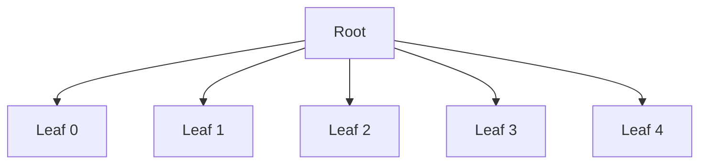
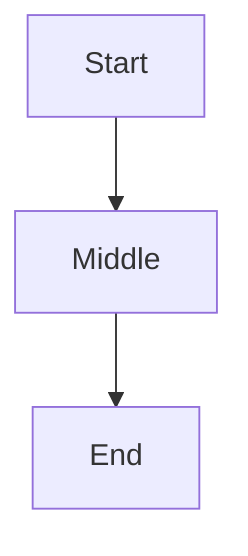

# 宽 Mermaid 图

验证 change `mermaid-large-diagrams` 的宽图规则:图先缩到正文栏宽,但不低于可读下限(`MIN_DIAGRAM_SCALE`);按下限仍比栏宽的图以下限显示、在自己的框内横向滚动,页面不横滚;拖滚动条不露源,点图本身露源。三张图的规模都在阈值以下,打开就渲染。

## 很宽:按栏宽缩会低于下限

一个根下 120 片叶子。应:文字可读(约 12 px),框内出横向滚动条,页面没有横向滚动。

## 中等宽:缩到栏宽仍高于下限

一个根下 5 片叶子(原宽约 750 px,缩到 656 px 栏宽是 0.87 倍,高于下限)。应(app 的 656 px 栏宽下):缩到栏宽(或原尺寸),没有滚动条。栏更窄时(如 demo 的约 494 px,0.66 倍低于下限)它按下限显示并在框内横滚,这也是对的。

## 窄

应:原尺寸居中,没有滚动条。

